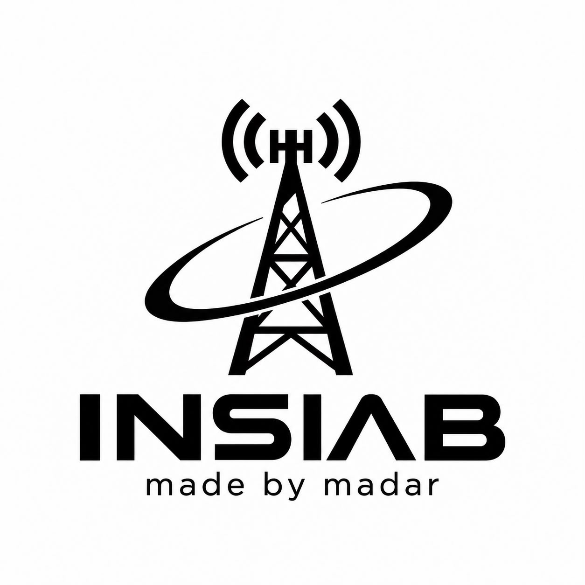

  

[اختيار اللغة](README.md) | [English](README.en.md)

# INSIAB | انسياب

**نفهم الحشود، ونيسّر الحركة.**

إدارة ذكية للحشود، وإرشاد للزوار، وتنسيق للمجموعات.

انسياب مشروع لمنصة تربط خريطة ثلاثية الأبعاد وحالة الازدحام والخدمات ومشاركة موقع المجموعة بعمليات التنظيم الميداني. يستهدف المواقع عالية الكثافة، مع اتخاذ الحرم المكي مثالًا للتطبيق.

**حالة هذه النسخة:** توثيق الفكرة وتصميم الحل المقترح. تحتوي على الشرح والشعار، ولا تتضمن ملفات تنفيذ التطبيق أو برنامج ESP32 أو نتائج اختبار ميداني. الميزات التالية تمثل رؤية المشروع وخطة تطويره.

📄 **[قراءة الشرح التفصيلي للمشروع — PDF عربي من 11 صفحة](project-overview-ar.pdf)**

## المشكلة

تتغير الحشود بسرعة، وقد يصل الزائر إلى خدمة مزدحمة أو ينفصل عن أسرته ومجموعته. وفي المقابل، يحتاج المنظّم إلى معلومات تساعده على التدخل مبكرًا وتوزيع المهام ومتابعة أثرها. كما تحتاج مرافق مثل دورات المياه إلى تقدير الإشغال دون تصوير مستخدميها.

## الحل المقترح

### تطبيق الحجاج والزوار

- خريطة ثلاثية الأبعاد للمناطق والطوابق والخدمات، مع حالة الازدحام وآخر تحديث.
- اقتراح مسارات وبدائل تراعي الازدحام وإمكانية الوصول وإغلاقات الممرات.
- إنشاء مجموعة ومشاركة مواقع أفرادها بموافقتهم، مع إدارة ولي الأمر لمشاركة أطفاله.
- نقطة تجمع مشتركة، وتنبيه عند الانفصال، وإظهار آخر موقع متاح ووقت تحديثه.
- مساعد ذكي يشرح حالة الخدمات والبدائل، ويعرض توقعات عند توفر نموذج وبيانات كافية.

### تطبيق المنظّمين

- متابعة المناطق ورصد مؤشرات ارتفاع الضغط.
- تطوير توقعات قصيرة المدى مع تقييم الدقة وإظهار الثقة.
- تحويل التنبيهات إلى مهام محددة بالموقع والأولوية والمسؤول.
- توزيع الأدوار ومتابعة قبول المهام وتنفيذها وتصعيدها.
- قياس أثر التدخل وتحديث اقتراحات الزوار دون نقل الازدحام إلى البديل.

## مصادر البيانات

| المصدر | الدور المقترح |
| --- | --- |
| الكاميرات | استخراج مؤشرات العدد والكثافة واتجاه الحركة في المواقع المناسبة، بعد إتاحة تكامل مخوّل. |
| ESP32 وWi-Fi CSI | تحليل تغيّرات القناة اللاسلكية لتجربة تقدير الوجود والحركة والإشغال، خصوصًا في مناطق لا تناسبها الكاميرات. |
| بيانات شبكة الواي فاي | مؤشرات مجمعة عن اتصال الأجهزة عند توفير التكامل؛ عدد الأجهزة لا يساوي عدد الأشخاص. |
| موقع الهاتف عبر التطبيق | الملاحة ومشاركة الموقع داخل المجموعة وفق الصلاحيات ودقة القياس والاتصال. |

تُربط البيانات بالمنطقة والتوقيت، وتُدمج وفق جودة المصدر. **تقدير الإشغال عبر CSI مستقل عن تحديد هوية وموقع عضو في المجموعة.**

## دورات المياه والخدمات

يستهدف المشروع تقدير إشغال مناطق دورات المياه باستخدام CSI دون كاميرات داخلها. يفرّق التصميم بين الإشغال وطول الطابور وزمن الانتظار، لأن كل مؤشر يحتاج قياسًا مناسبًا. ويمكن ربط ارتفاع الاستخدام بمهام تنظيف أو صيانة، مع تحديث حالة الخدمة للزائر.

## الخصوصية والاعتمادية

- مؤشرات الحشود المعروضة للعامة مجمعة على مستوى المنطقة.
- مواقع أفراد المجموعة ليست جزءًا من الخريطة العامة، ويمكن إنهاء المشاركة.
- تظهر دقة الموقع وآخر تحديث، ولا تُعرض البيانات القديمة كأنها حية.
- تُحفظ تعليمات نقطة التجمع عند الإمكان لمساعدة المجموعة عند ضعف الاتصال.
- لا يُفترض أن CSI يحدد إحداثيات كل شخص أو أن النجاح في غرفة اختبار يثبت الأداء في حشود الحرم.

## خطة النموذج الأولي

1. تحديد ثلاث مناطق اختبار وجمع بيانات CSI مع عدّ يدوي مرجعي.
2. إضافة مصدر كاميرا وخريطة مبسطة، مع وصف واضح لأي بيانات محاكاة.
3. تجربة مجموعة من هاتفين ونقطة تجمع وتنبيه ومهمة واحدة للمنظّم.
4. تقييم جودة التقدير وزمن التحديث والتنبيهات والموقع، ثم الانتقال لتجربة ميدانية محدودة.

التوسع اللاحق يشمل الخرائط ثلاثية الأبعاد والطوابق، ومسارات كبار السن والكراسي، والإرشاد متعدد اللغات، وتقارير الاختناقات المتكررة.

## ملفات المستودع

- [README.md](README.md): الصفحة الرئيسية واختيار اللغة.
- `README.ar.md`: الشرح العربي للمشروع.
- [README.en.md](README.en.md): الشرح الإنجليزي للمشروع.
- [project-overview-ar.pdf](project-overview-ar.pdf): الملف التفصيلي بالعربية.
- [project-overview-en.pdf](project-overview-en.pdf): الملف التفصيلي بالإنجليزية.
- [logo.jpg](logo.jpg): الشعار المعتمد للمشروع.

تتضمن ملفات PDF الرؤية الموسّعة وآلية العمل والحدود والمراجع التقنية.

## الفريق

**made by madar**
