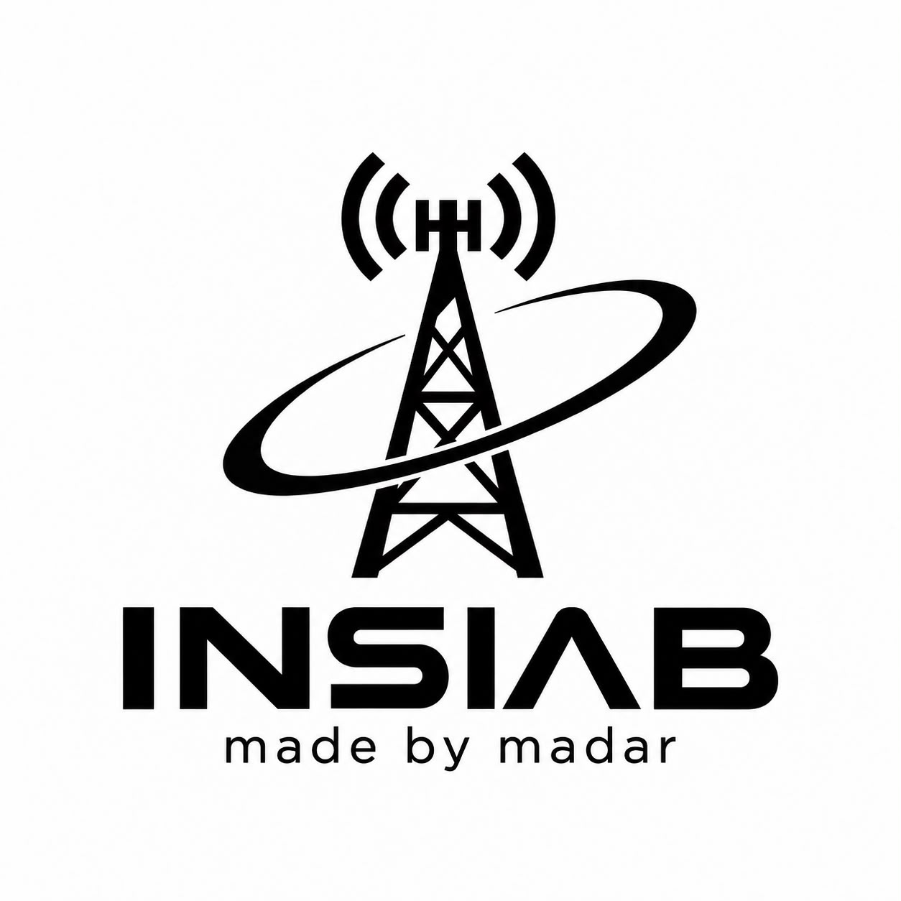

  

[Language selection](README.md) | [العربية](README.ar.md)

# INSIAB

**Understanding crowds. Enabling flow.**

Smart crowd management, visitor guidance, and group coordination.

INSIAB is a proposed platform that connects 3D maps, crowd and service conditions, and group location sharing with field operations. It targets high-density venues, using the Grand Mosque in Makkah as a proposed use case.

**Status of this version:** concept documentation and a proposed solution design. This package contains the overview and logo; application code, ESP32 firmware, and field-test results are not included. The features below represent the product vision and development plan.

**[Read the full project overview - 11-page English PDF](project-overview-en.pdf)**

## The problem

Crowd conditions change quickly. Visitors may arrive at a congested service or become separated from their family or group. Organizers need timely information to intervene early, allocate tasks, and assess their impact. Facilities such as restrooms also need occupancy estimates without cameras inside.

## Proposed solution

### Pilgrim and visitor app

- A 3D map of zones, floors, and services, showing crowd conditions and the last update.
- Routes and alternatives that consider congestion, accessibility, and corridor closures.
- Groups with consent-based member location sharing and guardian-managed sharing for children.
- A shared meeting point, separation alerts, and each member's last available location and timestamp.
- An AI assistant that explains current service conditions and alternatives, with forecasts when sufficient data and a validated model are available.

### Organizer app

- Monitor zones and detect signs of rising pressure.
- Develop and evaluate short-term forecasts with visible confidence information.
- Convert alerts into tasks with a location, priority, and owner.
- Assign roles and track task acceptance, execution, and escalation.
- Evaluate intervention outcomes and update visitor guidance without transferring congestion to the alternative.

## Data sources

| Source | Proposed role |
| --- | --- |
| Cameras | Derive counts, density, and movement direction in appropriate areas, subject to authorized integration. |
| ESP32 and Wi-Fi CSI | Analyze wireless-channel changes to test estimates of presence, movement, and occupancy, particularly in areas unsuitable for cameras. |
| Wi-Fi network data | Use aggregate device-connection indicators where integration is available; a device count is not a person count. |
| App-based phone location | Support navigation and group location sharing, subject to permissions, accuracy, and connectivity. |

Data is associated with a zone and timestamp and combined according to source quality. **CSI occupancy estimation is separate from identifying and locating a group member.**

## Restrooms and services

The project proposes CSI-based restroom-zone occupancy estimation without cameras inside. Occupancy, queue length, and waiting time are treated as separate indicators that require appropriate measurements. High usage can also lead to cleaning or maintenance tasks, with service availability updated for visitors.

## Privacy and reliability

- Public crowd indicators are aggregated at zone level.
- Group locations are not part of the public map, and sharing can be stopped.
- Location accuracy and the last update are displayed; stale data is not presented as live.
- Meeting-point instructions can be saved when possible for poor-connectivity situations.
- The design does not assume that CSI supplies every person's coordinates or that success in a test room proves performance at Haram crowd scale.

## Prototype plan

1. Define three test zones and collect CSI measurements alongside manual reference counts.
2. Add one camera source and a simplified map, clearly identifying simulated data.
3. Test a two-phone group, a shared meeting point, an alert, and one organizer task.
4. Evaluate estimation quality, update latency, alerts, and location performance before a limited field pilot.

Later expansion includes 3D floor maps, routes suitable for older visitors and wheelchair users, multilingual guidance, and reports on recurring bottlenecks.

## Repository files

- [README.md](README.md): bilingual entry page and language selection.
- [README.ar.md](README.ar.md): Arabic project overview.
- `README.en.md`: English project overview.
- [project-overview-ar.pdf](project-overview-ar.pdf): detailed Arabic document.
- [project-overview-en.pdf](project-overview-en.pdf): detailed English document.
- [logo.jpg](logo.jpg): the approved project logo.

The PDFs include the expanded vision, workflow, limitations, and technical references.

## Team

**made by madar**
