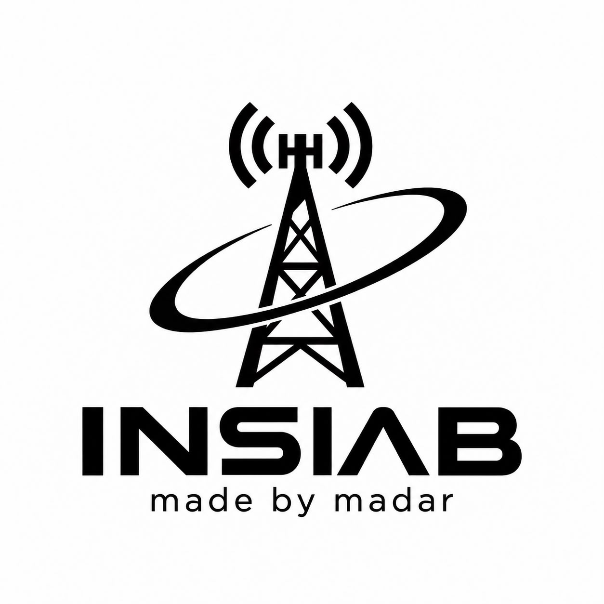

  

# INSIAB | انسياب

**نفهم الحشود، ونيسّر الحركة.**  
**Understanding crowds. Enabling flow.**

منصة مقترحة لإدارة الحشود وإرشاد الزوار وتنسيق المجموعات، تجمع الخرائط ثلاثية الأبعاد واستشعار الواي فاي وتحليل الكاميرات مع أدوات التنظيم الميداني.

A proposed platform for crowd management, visitor guidance, and group coordination, bringing together 3D maps, Wi-Fi sensing, computer vision, and field operations.

## اختر اللغة | Choose a language

| اللغة / Language | شرح المشروع / Project README | الملف التفصيلي / Full PDF |
| --- | --- | --- |
| العربية | [اقرأ الشرح العربي](README.ar.md) | [تحميل الملف العربي](project-overview-ar.pdf) |
| English | [Read the English overview](README.en.md) | [Download the English PDF](project-overview-en.pdf) |

## حالة هذه النسخة | Package status

تحتوي هذه النسخة على توثيق الفكرة وتصميم الحل والشعار. كود التطبيق وبرنامج ESP32 ونتائج الاختبار الميداني غير مرفقة بهذه النسخة؛ الميزات الموصوفة هي الرؤية المقترحة للمشروع.

This package contains concept documentation, the proposed solution design, and the logo. Application code, ESP32 firmware, and field-test results are not included. The described capabilities represent the proposed product vision.

**made by madar**
